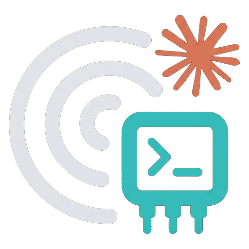

# Ai Chat Claude CLI Native

<p align="center">
  
</p>

JetBrains IDE plugin that **installs the Claude CLI agent** for **AI Chat** (ACP), so you can use **Claude Code Teams** with your existing terminal `claude` login — the same way as Cursor/Junie agents, without the JetBrains API-key Claude flow.

**Plugin ID:** `dev.nowtech.aichat.claudecli.native`  
**Vendor:** [NOW Tech](https://jetbrains.nowtech.dev)

## Requirements

- PhpStorm / IntelliJ **2026.2+** (build `262.10968+`)
- Bundled or installed plugin **AI Assistant** (`com.intellij.ml.llm`)
- **Claude Code CLI** installed and authenticated (`claude` in WSL or on the host)
- **Node.js** and **npm** where the agent runs (typically inside WSL on Windows)

## What it does

- Merges the **Claude CLI** entry into `~/.jetbrains/acp.json` (other agents are preserved)
- Deploys `~/.local/bin/claude-teams-acp` and installs `@agentclientprotocol/claude-agent-acp@0.99.0` under `~/.local/share/claude-teams-acp`
- Does **not** use `npx` (avoids JetBrains temporal npm policy that blocks very new package versions)
- Drops a **Claude icon** into the IDE’s ACP icon cache so **Claude CLI** in the Agents list is not the generic robot (JetBrains does not support `icon` in `acp.json` yet)
- **Windows + WSL projects:** writes Linux paths into `acp.json` so AI Chat starts the agent inside WSL (Eel), not via `wsl.exe` from Linux

After install: **AI Chat → Agents → Claude CLI** → new chat.

If the agent misbehaves after an upgrade: **AI Chat → Clear Downloaded Agent Files**, then **Tools → Install Claude CLI for AI Chat…** or restart the IDE.

## Features

- Auto install/repair on first startup (default **on**)
- **Settings → Tools → Ai Chat Claude CLI Native** — WSL distro id, manual install, last error
- **Tools → Install Claude CLI for AI Chat…**

## Build

1. Copy local paths:

   ```bash
   cp gradle.properties.example gradle.properties
   ```

   Edit `gradle.properties`:

   - `phpstorm.home` — your IDE install directory

2. Build the distribution ZIP:

   ```bash
   ./builder build
   ```

   Output: `build/distributions/aichat-claude-cli-native-*.zip`

**WSL tip:** first Gradle run against a Windows PhpStorm path can be slow. Reuse the platform cache from another NOW Tech plugin if you have one:

```bash
rm -rf .intellijPlatform
cp -a ../aichat-auto-apply/.intellijPlatform .
```

## Install

### Install from disk (development build)

1. **Settings → Plugins → ⚙ → Install Plugin from Disk…** → select the ZIP from `./builder build`
2. **Restart the IDE**

## Verify

Check the IDE log for:

```text
AI Chat Claude CLI Native: scheduling ACP install
AI Chat Claude CLI Native: install ok
```

Logger id: `dev.nowtech.aichat.claudecli.native`

Confirm `~/.jetbrains/acp.json` contains `"Claude CLI"` and that WSL has:

```bash
test -x ~/.local/bin/claude-teams-acp && test -f ~/.local/share/claude-teams-acp/node_modules/@agentclientprotocol/claude-agent-acp/dist/index.js
```

## Disclaimer

Uses JetBrains platform and AI Assistant APIs. May require updates when the IDE or ACP agent packaging changes. Not affiliated with JetBrains or Anthropic.

## License

[MIT](LICENSE) © [NOW Tech](https://jetbrains.nowtech.dev)
